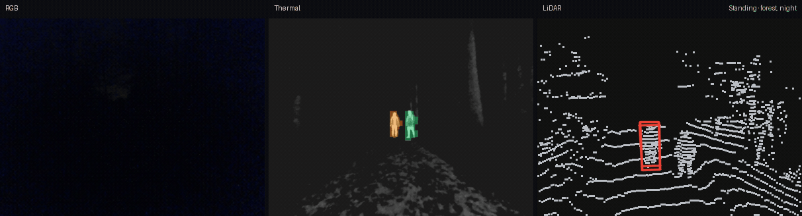
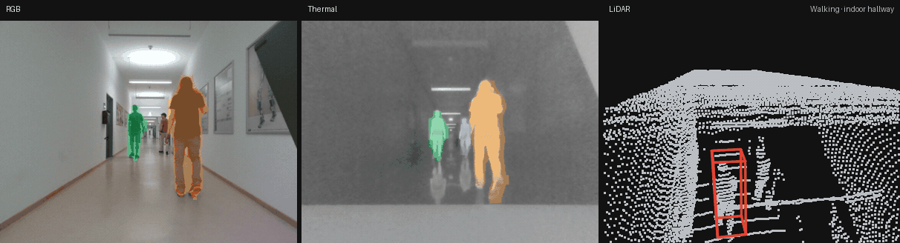
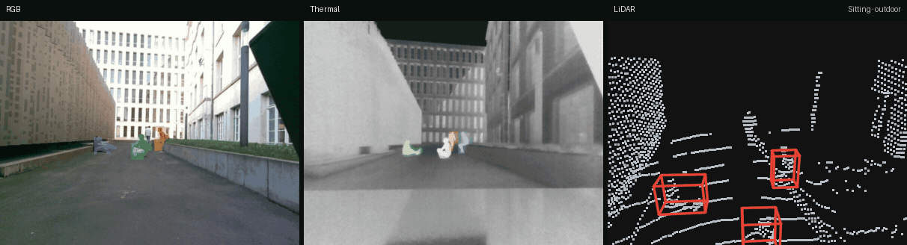
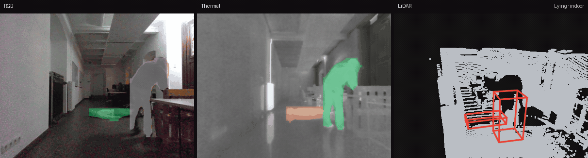
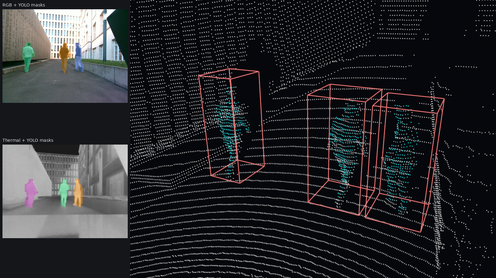

# PaintFusion: Trimodal 3D Person Detection

**TriSAR-3D and PaintFusion: A Novel Trimodal LiDAR–RGB–Thermal Dataset and Method for 3D Person Detection in Search and Rescue**

Markus Kramer\*, Jan Wachenfeld\*, Oskar von Stryk — Technical University of Darmstadt

Predicted segmentation masks and 3D boxes on four TriSAR-3D sequences. RGB and thermal show the instance masks; LiDAR shows the 3D boxes.

<table>
<tr>
<td width="50%" valign="top">
<strong>Standing, forest at night</strong><br>

</td>
<td width="50%" valign="top">
<strong>Walking, indoor hallway</strong><br>

</td>
</tr>
<tr>
<td width="50%" valign="top">
<strong>Sitting, outdoor</strong><br>

</td>
<td width="50%" valign="top">
<strong>Lying, indoor</strong><br>

</td>
</tr>
</table>

## Abstract

Reliable 3D person detection is critical for rescue robotics. Most multimodal 3D detection research targets automotive scenes, where pedestrians appear upright and near the road. It is unclear how much of that performance transfers when a person is lying, partially occluded, or in an unstructured indoor or outdoor environment. We introduce TriSAR-3D, a trimodal person detection dataset recorded with a 128-channel LiDAR, an RGB camera, and a thermal camera. It covers standing, walking, sitting, and lying poses indoors and outdoors, by day and at night. We also propose PaintFusion, a trimodal detector that fuses PointPainting-style evidence with an MLP on painted cluster features. PaintFusion reaches 65.4 AP@50 and outperforms strong LiDAR-only (CenterPoint, 53.4), RGB+LiDAR (BEVFusion, 60.5), and trimodal (Tri-BEVFusion, 60.7) baselines, at 51.6 ms per frame compared with 101 ms for BEVFusion. Removing lying instances from training collapses lying-pose AP@50 to near zero for every detector we evaluate. Dataset diversity has a large effect on 3D detection performance.

## Results

AP@50 on the TriSAR-3D test split. People are evaluated from 5 m to 30 m, excluding severely occluded instances. Latency is the mean per-frame time on an Intel Core i9-12900H with an NVIDIA GeForce RTX 3080 Ti Laptop GPU.

| Regime | Method | AP@50 | Standing | Lying | Walking | Sitting | Latency (ms) |
|--------|--------|------:|---------:|------:|--------:|--------:|-------------:|
| LiDAR-only | PointPillars | 47.1 | 20.6 | 11.0 | 59.8 | 27.1 | **15.6** |
| LiDAR-only | PV-RCNN | 38.6 | 20.2 | 12.0 | 44.1 | 25.3 | 79.6 |
| LiDAR-only | SECOND | 32.6 | 18.0 | 22.1 | 41.2 | 14.2 | 23.8 |
| LiDAR-only | CenterPoint | 53.4 | 21.9 | **23.8** | 62.5 | 33.9 | 31.5 |
| RGB+LiDAR | BEVFusion | 60.5 | 32.3 | 22.3 | 62.6 | 45.0 | 101.0 |
| RGB+LiDAR | PointPainting | 43.7 | 23.9 | 1.6 | 55.1 | 15.1 | 57.7 |
| Thermal+LiDAR | Thermal PointPainting | 52.2 | 32.9 | 2.9 | 62.3 | 22.8 | 56.9 |
| Trimodal | Tri-BEVFusion | 60.7 | **36.4** | 19.3 | **71.0** | 38.8 | 107.1 |
| Trimodal | Tri-PointPainting | 51.4 | 21.7 | 3.9 | 64.7 | 19.1 | 105.6 |
| Trimodal | **PaintFusion (Ours)** | **65.4** | 22.6 | 18.4 | 68.0 | **49.7** | 51.6 |

## Installation

```bash
git clone --recurse-submodules git@github.com:MarkusKramer1/3D-Trimodal-People-Detection.git
cd 3D-Trimodal-People-Detection
git lfs install && git lfs pull
bash scripts/setup_conda_env.sh
conda activate paintfusion
```

The conda env is Python 3.10 with PyTorch 2.1.2 (CUDA 12.1), MMDetection3D from `third_party/mmdetection3d` (`dev-1.x`), and the packages in `requirements.txt`.

## Dataset

[TriSAR-3D](https://tudatalib.ulb.tu-darmstadt.de/items/383ef57d-559d-48a4-a697-28103f1eb120) is the dataset release on TUdatalib (`3d_trimodal_people_detection_dataset.zip`). Unzip it and pass that folder as `--data-root`. Each `rosbag2_*` directory next to `dataset.json` is one sequence, with `links.json`, `samples.json`, `calibrations.json`, `annotations.json`, `split.json`, the RGB and thermal COCO files, and `samples/lidar`, `samples/rgb`, and `samples/thermal`.

```bash
python scripts/run_pipeline.py \
  --data-root /path/to/TriSAR-3D \
  --scene rosbag2_2025_09_18-16_04_08_out \
  --device cuda:0
```

## Demo



`sample_data/` contains one frame in the same layout.

```bash
python scripts/demo_visualize.py --device cuda:0
python scripts/run_pipeline.py --device cuda:0
python scripts/verify_env.py --device cuda:0 --run-pipeline
```

| Flag | Default | Meaning |
|------|---------|---------|
| `--data-root` | `sample_data/` | Dataset root |
| `--scene` | `example_scene` | Sequence folder name |
| `--frame-idx` | `0` | Frame index |
| `--score-thr` | `0.1` | 3D score threshold |
| `--device` | `cuda:0` | PyTorch device |
| `--save-detections` | — | Write detections as JSON (`run_pipeline.py` only) |

## Weights

Pretrained weights ship in `checkpoints/`: YOLO26n-seg for RGB and thermal, the seed-scorer MLP, and the PointPillars head.

## Baselines

`configs/baselines/` contains one MMDetection3D training config per detector in the paper. The architecture is in `configs/baselines/models/`. Each training config reads `data/trisar3d`: `infos_{train,val,test}.pkl` for the LiDAR baselines, and `infos_pointpainting_{train,val,test}.pkl` for PointPainting. Train one from this repository:

```bash
export PYTHONPATH="$(pwd):$(pwd)/third_party/mmdetection3d:${PYTHONPATH}"
python third_party/mmdetection3d/tools/train.py configs/baselines/pointpillars.py
```

## Citation

```bibtex
@inproceedings{kramer2026trisar3d,
  title     = {{TriSAR-3D} and {PaintFusion}: A Novel Trimodal {LiDAR}--{RGB}--Thermal Dataset and Method for {3D} Person Detection in Search and Rescue},
  author    = {Kramer, Markus and Wachenfeld, Jan and von Stryk, Oskar},
  booktitle = {IEEE International Symposium on Safety, Security, and Rescue Robotics (SSRR)},
  year      = {2026}
}
```

## Acknowledgements

3D detection uses [MMDetection3D](https://github.com/open-mmlab/mmdetection3d). Instance segmentation uses [Ultralytics YOLO26](https://github.com/ultralytics/ultralytics).
